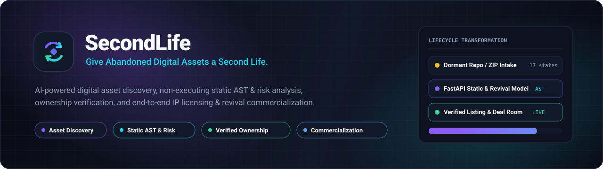
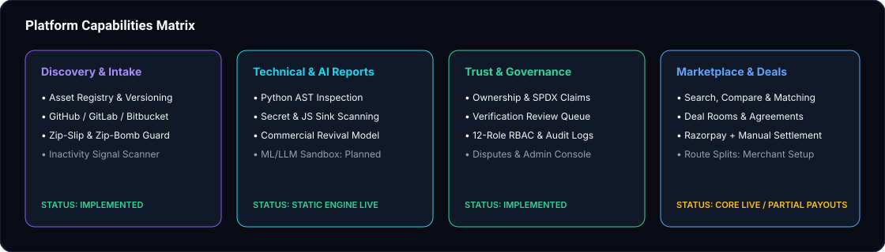
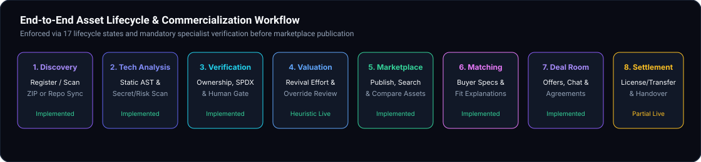
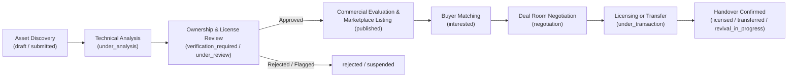
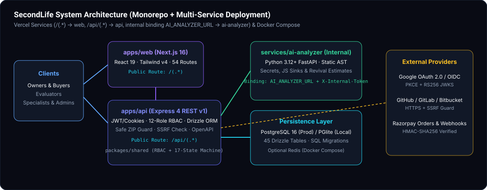
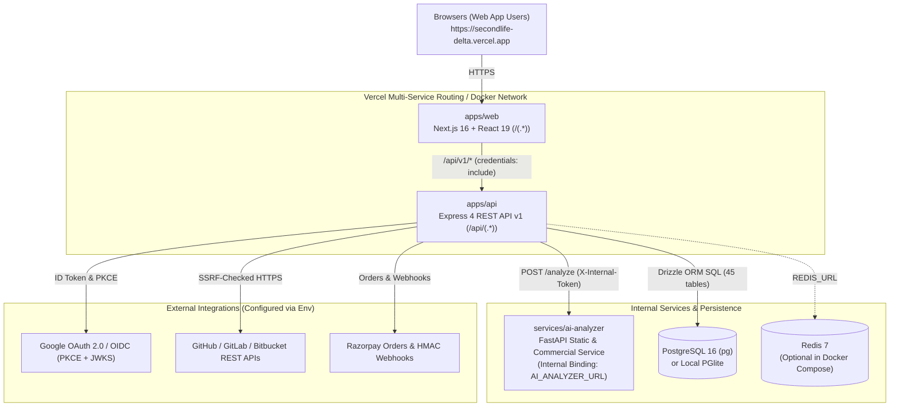
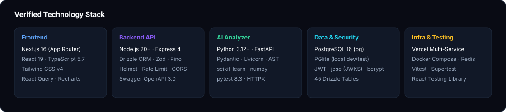

<a id="top"></a>
<div align="center">
  <a href="https://secondlife-delta.vercel.app/">
    
  </a>

  <br /><br />

  <picture>
    <source media="(prefers-color-scheme: dark)" srcset="docs/assets/branding/logo-dark.svg" />
    <source media="(prefers-color-scheme: light)" srcset="docs/assets/branding/logo-light.svg" />
    
  </picture>

  <p><strong>Give Abandoned Digital Assets a Second Life.</strong></p>
  <p>
    An AI-powered platform for discovering, evaluating, verifying, and commercializing underutilized digital assets.
  </p>

  <p>
    <a href="https://secondlife-delta.vercel.app/"></a>
    <a href="https://github.com/sujaldev28/SecondLife"></a>
    <a href=".github/workflows/ci.yml"></a>
    
    
    
    
    
    
  </p>

  <p>
    <a href="https://secondlife-delta.vercel.app/">Live App</a> •
    <a href="#product-overview">Overview</a> •
    <a href="#platform-capabilities">Capabilities</a> •
    <a href="#how-it-works">How It Works</a> •
    <a href="#platform-architecture">Architecture</a> •
    <a href="#installation-and-setup">Setup</a> •
    <a href="#api-documentation">API</a> •
    <a href="#security">Security</a> •
    <a href="docs/PRODUCT_OVERVIEW.md">Docs</a>
  </p>
</div>

---

## Table of Contents

- [Product Overview](#product-overview)
- [The Problem & Our Solution](#the-problem--our-solution)
- [Platform Capabilities](#platform-capabilities)
- [How It Works](#how-it-works)
- [User Roles & Permissions](#user-roles--permissions)
- [Platform Architecture](#platform-architecture)
- [Technology Stack](#technology-stack)
- [Repository Structure](#repository-structure)
- [Installation and Setup](#installation-and-setup)
- [Environment Variables](#environment-variables)
- [API Documentation](#api-documentation)
- [AI Analyzer Documentation](#ai-analyzer-documentation)
- [Security](#security)
- [Visual Assets & Screenshots](#visual-assets--screenshots)
- [Roadmap](#roadmap)
- [Business Model](#business-model)
- [Contributing](#contributing)
- [License & Legal Notice](#license--legal-notice)

---

## Product Overview

**SecondLife** is a multi-service software evaluation and commercialization platform built to bridge the gap between dormant engineering assets and organizations looking for verified, reusable technical IP.

- **Live Deployment:** [https://secondlife-delta.vercel.app/](https://secondlife-delta.vercel.app/)
- **Source Repository:** [https://github.com/sujaldev28/SecondLife](https://github.com/sujaldev28/SecondLife)
- **Supported Asset Types:** `source_code`, `web_application`, `library_sdk`, `algorithm_model`, `developer_tool`, `research_prototype`, `api_service`, `documentation_dataset`
- **Commercialization Arrangements:** `non_exclusive_license`, `exclusive_license`, `full_transfer`, `revival_partnership`, `repurposing_partnership`

Unlike an unverified code bazaar, SecondLife separates **inactivity signals**, **non-executing static analysis**, **explicit ownership & SPDX verification gates**, and **audited deal-room transactions** across a **17-state asset lifecycle** persisted in a **45-table PostgreSQL schema**.

---

## The Problem & Our Solution

### The Problem
- **Underutilized Engineering Value:** Valuable internal tools, paused startup codebases, libraries, and research prototypes accumulate inside dormant repositories while teams elsewhere rebuild identical foundations from scratch.
- **Hidden Technical & Security Risk:** Raw archives rarely communicate maintainability debt, exposed credentials, unpinned dependencies, or realistic modernization costs upfront.
- **IP & Ownership Ambiguity:** Repository inactivity never implies ownership waiver or redistribution permission. Commercializing dormant code without explicit legal and license verification creates unacceptable compliance risk.

### Our Solution
1. **Controlled Discovery & Intake:** Owners register assets manually, upload ZIP archives guarded against traversal and zip bombs, or synchronize authorized GitHub, GitLab, and Bitbucket repositories over SSRF-hardened HTTPS APIs.
2. **Isolated Technical & Commercial Evaluation:** `services/ai-analyzer` inspects Python ASTs, JS/TS security sinks, exposed secret patterns, and package manifests without executing submitted code—producing transparent quality scores, revival hours, and INR cost/value bounds.
3. **Compliance-First Verification Gates:** Mandatory ownership declarations, contributor disclosures, and specialist approvals (`verification_specialist` / `platform_admin`) precede marketplace publication.
4. **Structured Deal Rooms & Handover:** Buyers discover listings via multi-facet filtering and explainable matching, negotiate offers, sign agreements, track Razorpay or invoice settlements, and confirm asset handover with full audit logs.

---

## Platform Capabilities

<p align="center">
  
</p>

All statuses below are verified against source code in `apps/`, `packages/`, and `services/`:

| Category | Capability | Status | Source Reference |
| :--- | :--- | :--- | :--- |
| **Digital Asset Discovery** | Asset CRUD, 17-state lifecycle transitions, ZIP upload inspection (Zip Slip / zip-bomb guard), GitHub/GitLab/Bitbucket sync, inactivity candidate scan & import | **Implemented** | [`apps/api/src/modules/assets/assets.routes.ts`](apps/api/src/modules/assets/assets.routes.ts) |
| **AI & Technical Intelligence** | Python AST inspection, language & LOC breakdown, test/README/CI detection, `package.json` & `requirements.txt` parsing, Node fallback when Python worker offline | **Implemented** *(static deterministic)* | [`services/ai-analyzer/app/analyzer.py`](services/ai-analyzer/app/analyzer.py) |
| **Security Assessment** | Credential regex scanning (AWS, GitHub, PEM keys, hardcoded literals with `[REDACTED]` evidence), JS/TS dangerous sink checks, Python `eval`/`exec`/`system` AST alerts | **Implemented** | [`services/ai-analyzer/app/analyzer.py`](services/ai-analyzer/app/analyzer.py) |
| **Commercial Opportunity Analysis** | Reusability & commercial scores, INR revival cost/value model (`INR 2,500–3,800/hr` baseline), confidence bounds, evaluator manual overrides | **Implemented** *(heuristic model)* | [`apps/api/src/modules/analysis/analysis.routes.ts`](apps/api/src/modules/analysis/analysis.routes.ts) |
| **Ownership & Licensing Verification** | Ownership declarations, contributor disclosures, SPDX license metadata, evidence vault, specialist queue, disputes filing & resolution | **Implemented** | [`apps/api/src/modules/verification/verification.routes.ts`](apps/api/src/modules/verification/verification.routes.ts) |
| **Asset Marketplace & Matching** | Public & authenticated listing search/filters, side-by-side comparison, saved assets, buyer requirements, explainable match scoring (`reasons` & `gaps`) | **Implemented** | [`apps/api/src/modules/marketplace/marketplace.routes.ts`](apps/api/src/modules/marketplace/marketplace.routes.ts) |
| **Collaboration & Deal Rooms** | Buyer inquiries, deal room threads, participant messaging, offers & counter-offers, commercial agreements & signing | **Implemented** | [`apps/api/src/modules/deals/deals.routes.ts`](apps/api/src/modules/deals/deals.routes.ts) |
| **Transactions & Handover** | Server-side commission calculation, Razorpay order/HMAC webhook verification, manual settlement confirmation, refunds, handover delivery/receipt | **Partially Implemented** *(live checkout & Route splits require merchant onboarding)* | [`apps/api/src/modules/transactions/transactions.routes.ts`](apps/api/src/modules/transactions/transactions.routes.ts) |
| **Auth, OAuth & Demo Access** | Email/password auth, verification/reset tokens, Google OAuth 2.0/OIDC (PKCE + JWKS RS256), 5 gated fictional demo accounts | **Implemented** *(Google OAuth requires client credentials)* | [`apps/api/src/modules/auth/auth.routes.ts`](apps/api/src/modules/auth/auth.routes.ts) |
| **Orgs, RBAC & Governance** | Multi-tenant orgs, workspaces, invitations, 12-role RBAC, org audit logs, subscription plans, admin console & system settings | **Implemented** | [`apps/api/src/modules/organizations/org.routes.ts`](apps/api/src/modules/organizations/org.routes.ts), [`apps/api/src/modules/admin/admin.routes.ts`](apps/api/src/modules/admin/admin.routes.ts) |
| **Email & Object Storage** | Development `console` email logger + local ZIP inspection implemented; SMTP relay transport & S3 client hooks defined | **Partially Implemented** *(SMTP/S3 delivery clients not wired)* | [`apps/api/src/services/email.service.ts`](apps/api/src/services/email.service.ts), [`.env.example`](.env.example) |
| **ML/LLM & Runtime Sandboxes** | `OPENAI_API_KEY` / `GEMINI_API_KEY` slots, `scikit-learn` packaged, container test execution, live OSV feed, ClamAV upload daemon | **Planned** | [`docs/KNOWN_LIMITATIONS.md`](docs/KNOWN_LIMITATIONS.md) |

---

## How It Works

<p align="center">
  
</p>

The 17-state transition machine in [`packages/shared/src/lifecycle.ts`](packages/shared/src/lifecycle.ts) governs every asset from intake to commercialization:



- **Operational Today:** Intake, static AST/risk & heuristic commercial evaluation, verification gates, marketplace matching, deal negotiation, agreement signing, and handover tracking.
- **Requires Merchant Setup / Planned:** Live Razorpay split settlements (`Razorpay Route`) and automated container test execution inside isolated sandboxes.

---

## User Roles & Permissions

Server-side RBAC in [`packages/shared/src/roles.ts`](packages/shared/src/roles.ts) enforces **12 roles** and granular permission keys across every protected route:

| Role | Responsibility | Key Permission Scope |
| :--- | :--- | :--- |
| `individual_owner`, `asset_owner` | Register, submit, verify, publish, and commercialize assets | `asset:*`, `discovery:run/read`, `analysis:trigger/read_own`, `verification:submit`, `deal:negotiate`, `handover:deliver` |
| `buyer` | Discover listings, define requirements, negotiate deals, settle & confirm receipt | `marketplace:*`, `requirements:manage`, `deal:create/negotiate`, `transaction:initiate`, `handover:confirm` |
| `developer` | Create/update assets, trigger static evaluation, browse & compare listings | `asset:create/read_own/update_own`, `analysis:trigger/read_own/read_public`, `marketplace:browse/compare` |
| `enterprise_member` | Organizational owner + buyer workflows plus confidential risk access | Owner + Buyer permissions + `analysis:read_confidential` |
| `org_admin`, `org_owner` | Manage org members, invitations, workspaces, audit logs, and subscriptions | Owner + Buyer permissions + `org:manage`, `org:invite`, `org:audit_read`, `workspace:manage`, `subscription:manage` |
| `evaluator` | Inspect confidential reports and override commercial assumptions with reasoning | `analysis:trigger`, `analysis:read_confidential`, `analysis:override`, `admin:ai_monitor` |
| `verification_specialist` | Review ownership evidence, approve/reject claims, resolve disputes | `verification:review`, `verification:approve`, `verification:dispute_resolve`, `admin:assets` |
| `deal_manager` | Oversee platform deal rooms, offers, agreements, and transactions | `deal:manage_all`, `deal:negotiate`, `agreement:create`, `admin:transactions` |
| `platform_admin` | Platform governance, user/org status, moderation, refunds, analytics & settings | `marketplace:moderate`, `verification:*`, `transaction:refund`, `admin:*` |
| `super_admin` | Full system administration across all permissions | All keys in `PERMISSIONS` |

---

## Platform Architecture

<p align="center">
  
</p>



### Component Breakdown
- **`packages/shared` (`@secondlife/shared`):** Shared TypeScript RBAC roles/permissions, 17-state asset lifecycle transitions, and Zod schemas.
- **`apps/web` (`@secondlife/web`):** Next.js 16 App Router application (`54` compiled routes across public pages, auth, Owner Console, Buyer Console, Deal Room, and Admin Console). Uses relative `/api/v1` on Vercel deployments and `http://localhost:4000/api/v1` in standalone local dev.
- **`apps/api` (`@secondlife/api`):** Express v1 REST API with Drizzle ORM, JWT + rotating cookie sessions, Swagger OpenAPI (`/api-docs`, `/api/docs`), Helmet, CORS/CSRF protections, rate limiting, `src/index.ts` (Vercel serverless entrypoint with lazy DB initialization), and `src/server.ts` (standalone Node server).
- **`services/ai-analyzer`:** Isolated Python FastAPI service (`app.main:app`) reachable privately from `apps/api` via Vercel's `AI_ANALYZER_URL` service binding (or `AI_SERVICE_URL` in Docker/local dev), authenticated with `X-Internal-Token`.

---

## Technology Stack

<p align="center">
  
</p>

| Domain | Verified Stack & Libraries |
| :--- | :--- |
| **Frontend** | Next.js `16.1+` (App Router), React `19`, TypeScript `5.7`, Tailwind CSS `4`, TanStack React Query `5`, Recharts `2.15`, Lucide React, Zod `3.24` |
| **Backend** | Node.js `>=20`, Express `4.21`, TypeScript `5.7`, Drizzle ORM `0.45`, Pino `9.6`, Multer `2.5`, AdmZip `0.5`, Helmet `8`, CORS `2.8`, Express Rate Limit `7.5`, Swagger UI Express `5` |
| **AI & Analysis** | Python `3.12+`, FastAPI `0.115.6`, Uvicorn `0.34.0`, Pydantic `2.10.4`, HTTPX `0.28.1`, `ast` stdlib *(plus `scikit-learn 1.6.1` & `numpy 2.2.1` dependencies)* |
| **Database** | PostgreSQL `16` (`pg 8.14`, `drizzle-kit 0.30`), `@electric-sql/pglite 0.6` (local/test PostgreSQL), `45` Drizzle `pgTable` schemas |
| **Authentication** | `jsonwebtoken` (`HS256`), `jose` (Google OIDC JWKS `RS256`), `bcryptjs`, `cookie-parser`, `node:crypto` (`SHA-256`, `HMAC-SHA256`, PKCE `S256`) |
| **Infrastructure** | Vercel Multi-Service (`vercel.json`), Docker & Docker Compose (`postgres:16-alpine`, `redis:7-alpine`), GitHub Actions CI, Dependabot |
| **Developer & QA Tools** | Vitest `3`, Supertest `7`, React Testing Library `16` + `jsdom`, `pytest 8.3.4`, `tsx 4.19`, npm workspaces |

---

## Repository Structure

```text
SecondLife/
├── .github/                        # Issue templates, PR template, Dependabot & CI workflow
├── .editorconfig                   # Cross-editor formatting defaults (TS/JS/JSON/YAML/Python)
├── .env.example                    # Safe environment variable reference template
├── CHANGELOG.md                    # Versioned project changelog
├── CODE_OF_CONDUCT.md              # Contributor Covenant v2.1
├── CONTRIBUTING.md                 # Developer workflow, standards & PR checklist
├── SECURITY.md                     # Vulnerability reporting & disclosure policy
├── docker-compose.yml              # Multi-container stack (postgres, redis, ai-analyzer, api, web)
├── package.json                    # Root npm workspaces & scripts
├── vercel.json                     # Vercel Multi-Service routing & internal ai-analyzer binding
├── packages/
│   └── shared/                     # @secondlife/shared (RBAC roles, lifecycle machine, Zod schemas)
├── apps/
│   ├── api/                        # @secondlife/api (Express REST v1, Drizzle DB, auth, Vercel entrypoint)
│   └── web/                        # @secondlife/web (Next.js 16 App Router UI & API client)
├── services/
│   └── ai-analyzer/                # Python FastAPI static AST, security & commercial analyzer
└── docs/                           # Architecture, API, AI, security, DB, deployment docs & SVG assets
    └── assets/                     # Branding SVGs, hero/social banners, diagrams & screenshots README
```

---

## Installation and Setup

### Prerequisites
- **Node.js** `>= 20.0.0` and **npm** `>= 10.0.0` (verified with Node `v22.14.0`, npm `10.9.2`)
- **Python** `3.12+` *(optional for local execution; API provides deterministic fallback if offline)*
- *(Optional)* **PostgreSQL 16** — local development uses embedded `@electric-sql/pglite` at `.data/pglite` automatically when `DATABASE_URL` starts with `pglite://`

### 1. Clone & Install JS/TS Dependencies

```bash
git clone https://github.com/sujaldev28/SecondLife.git
cd SecondLife
cp .env.example .env
npm install
npm --workspace=packages/shared run build
```

### 2. Optional: Python AI Analyzer Setup

```bash
cd services/ai-analyzer
python -m venv .venv

# Windows PowerShell:
.\.venv\Scripts\Activate.ps1
# macOS / Linux:
# source .venv/bin/activate

pip install -r requirements.txt
cd ../..
```

### 3. Database Setup & Seed

Running `npm run dev:api` executes migrations and baseline seeding automatically. To invoke them directly:

```bash
npm run db:migrate
npm run db:seed
```

### 4. Start Services Locally

```bash
# Terminal 1 — Isolated Python AI Analyzer (port 8000)
cd services/ai-analyzer
uvicorn app.main:app --host 127.0.0.1 --port 8000

# Terminal 2 — Express REST API (port 4000)
npm run dev:api

# Terminal 3 — Next.js Frontend (port 3000)
npm run dev:web
```

- **Web App:** `http://localhost:3000`
- **API Base:** `http://localhost:4000/api/v1`
- **Swagger UI:** `http://localhost:4000/api-docs` (`/api/v1/openapi.json` for schema)
- **API Health:** `http://localhost:4000/health`

### 5. Build, Typecheck & Test Commands

```bash
npm run typecheck
npm run build
npm test
cd services/ai-analyzer && pytest -v
```

### 6. Deployment
- **Vercel (`vercel.json`):** Deploys `web` (`/(.*)`), `api` (`/api/(.*)`), and private `ai-analyzer` as one Vercel project (`https://secondlife-delta.vercel.app/`). See [`docs/DEPLOYMENT_GUIDE.md`](docs/DEPLOYMENT_GUIDE.md).
- **Docker Compose (`docker-compose.yml`):** Run `docker compose up --build` after supplying `JWT_ACCESS_SECRET`, `JWT_REFRESH_SECRET`, `POSTGRES_PASSWORD`, and `INTERNAL_SERVICE_TOKEN`.

---

## Environment Variables

Template: [`.env.example`](.env.example) | Guide: [`docs/ENVIRONMENT_CONFIGURATION.md`](docs/ENVIRONMENT_CONFIGURATION.md)

| Variable | Consumed By | Local Default | Production Note |
| :--- | :--- | :--- | :--- |
| `NODE_ENV` | `apps/api` | `development` | Set `production` (rejects `dev-` JWT secrets, skips demo seeding) |
| `DATABASE_URL` | `apps/api` | `pglite://./.data/pglite` | Provision managed `postgresql://...` URI in production |
| `DATABASE_SSL` | `apps/api` | `false` | Set `true` when required by managed PostgreSQL |
| `JWT_ACCESS_SECRET` / `JWT_REFRESH_SECRET` | `apps/api` | `change-this-...` | Required 32+ char random secrets |
| `COOKIE_SECURE` | `apps/api` | `false` | Set `true` behind HTTPS |
| `INTERNAL_SERVICE_TOKEN` | `apps/api`, `services/ai-analyzer` | `change-this-...` | Shared `X-Internal-Token` authenticating internal analyzer calls |
| `AI_ANALYZER_URL` | `apps/api` | *(Vercel runtime binding)* | **Do not set manually**; injected by Vercel via `vercel.json` |
| `AI_SERVICE_URL` | `apps/api` | `http://localhost:8000` | Standalone / Docker Compose fallback URL |
| `DEMO_MODE_ENABLED` | `apps/api` | `true` | Keep `false` in production unless demonstrating |
| `APP_URL` / `API_URL` / `CORS_ORIGINS` | `apps/api` | `http://localhost:3000` / `:4000` | Auto-derived from Vercel host if omitted on Vercel |
| `GOOGLE_OAUTH_CLIENT_ID` / `_SECRET` / `_REDIRECT_URI` | `apps/api` | *(empty)* | Required only for Google Sign-In (`.../api/v1/auth/google/callback`) |
| `RAZORPAY_KEY_ID` / `_KEY_SECRET` / `_WEBHOOK_SECRET` | `apps/api` | *(empty)* | Required only for live Razorpay order creation & webhook verification |
| `GITHUB_TOKEN` / `GITLAB_TOKEN` / `BITBUCKET_TOKEN` | `apps/api` | *(empty)* | Optional API tokens for higher rate limits & authorized repo metadata |
| `NEXT_PUBLIC_API_URL` | `apps/web` | `http://localhost:4000/api/v1` | **Omit on Vercel** so browser requests use same-origin `/api/v1` |

---

## API Documentation

- **Swagger UI:** `GET /api-docs` (or `GET /api/docs` behind Vercel `/api/(.*)` routing)
- **OpenAPI 3.0 Spec:** `GET /api/v1/openapi.json`
- **Health:** `GET /health` and `GET /api/health`
- **Detailed Guide:** [`docs/API_DOCUMENTATION.md`](docs/API_DOCUMENTATION.md)

<details>
<summary><strong>Click to view verified API endpoints across all modules (/api/v1)</strong></summary>

| Module | Endpoints | Auth Requirement |
| :--- | :--- | :--- |
| **Auth** | `GET /auth/config`, `POST /auth/register`, `POST /auth/verify-email`, `POST /auth/resend-verification`, `POST /auth/login`, `GET /auth/google/start`, `GET /auth/google/callback`, `POST /auth/refresh`, `POST /auth/logout`, `POST /auth/forgot-password`, `POST /auth/reset-password`, `GET/PATCH /auth/me`, `GET/DELETE /auth/sessions(/:id)`, `POST /auth/deactivate` | Public for registration/login/OAuth/reset; Authenticated (`Bearer` or cookie) for `/me`, `/sessions`, `/deactivate` |
| **Organizations** | `GET /subscriptions/plans`, `GET/POST /organizations`, `POST /organizations/switch`, `GET /organizations/:orgId/members`, `POST /organizations/:orgId/invitations`, `POST /organizations/invitations/accept`, `PATCH /organizations/:orgId/members/:memberId/role`, `GET/POST /organizations/:orgId/workspaces`, `GET /organizations/:orgId/audit-logs`, `GET/POST /organizations/:orgId/subscription` | Authenticated + Org membership / Org Admin (`plans` public) |
| **Assets & Discovery** | `GET /categories`, `GET/POST /assets`, `GET /assets/:id`, `POST /assets/:id/upload-archive`, `POST /assets/:id/sync-repository`, `POST /assets/:id/transition`, `GET /discovery/candidates`, `POST /discovery/scan`, `POST /discovery/candidates/:id/import` | Authenticated + RBAC (`categories` public) |
| **Verification** | `POST /assets/:id/ownership-declaration`, `GET /assets/:id/verification`, `GET /verification/queue`, `POST /verification/:requestId/decision`, `POST /assets/:id/disputes`, `GET /disputes`, `POST /disputes/:id/resolve` | Authenticated + Owner / Specialist / Admin |
| **AI Analysis** | `POST /assets/:id/analyze`, `GET /assets/:id/reports`, `POST /reports/:commercialReportId/override` | Authenticated (`override` requires `evaluator` or `platform_admin`) |
| **Marketplace** | `GET /marketplace/listings`, `GET /marketplace/listings/:id`, `GET /marketplace/compare`, `POST /assets/:id/publish-listing`, `GET/POST/DELETE /saved-assets`, `GET/POST /buyer/requirements`, `GET /buyer/recommendations` | Browse/compare public; publish/save/requirements/recommendations authenticated |
| **Deals & Transactions** | `POST/GET /inquiries`, `POST /inquiries/:id/respond`, `GET /deals`, `GET /deals/:id`, `POST /deals/:id/messages`, `POST /deals/:id/offers`, `POST /offers/:offerId/respond`, `POST /deals/:id/agreements`, `POST /agreements/:agreementId/sign`, `POST /deals/:id/transactions/initiate`, `POST /transactions/:id/verify-razorpay`, `POST /payments/webhooks/razorpay`, `POST /transactions/:id/confirm-settlement`, `POST /transactions/:id/refund`, `GET /transactions`, `POST /deals/:id/handover/deliver`, `POST /deals/:id/handover/confirm` | Deal participants / Admin (`webhooks/razorpay` verified by HMAC-SHA256) |
| **Admin & Notifications** | `GET /notifications`, `POST /notifications/:id/read`, `GET /admin/overview`, `GET /admin/users`, `PATCH /admin/users/:id/status`, `GET /admin/organizations`, `GET /admin/assets`, `GET /admin/marketplace`, `POST /admin/marketplace/:listingId/moderate`, `GET /admin/ai-jobs`, `GET /admin/security-events`, `GET /admin/settings`, `PUT /admin/settings/:key` | Authenticated + Admin roles (`notifications` per user) |

</details>

---

## AI Analyzer Documentation

`services/ai-analyzer` exposes `GET /health`, `POST /analyze`, and `POST /match` (requires `X-Internal-Token`). See [`docs/AI_ARCHITECTURE.md`](docs/AI_ARCHITECTURE.md).

- **Implemented Operations:**
  - Safe ZIP pre-screening in `apps/api` (magic bytes, size limit, `<= 5,000` files, `<= 150 MB` decompressed, `<= 100:1` compression ratio, Zip Slip traversal rejection).
  - Non-executing Python `ast` inspection (`eval`, `exec`, `system`, `popen`, docstring/class/function counts).
  - JS/TS static security pattern scan (`eval`/`Function`, `dangerouslySetInnerHTML`/`innerHTML`, `child_process.exec`/`execSync`).
  - Secret scanning with `[REDACTED FOR SECURITY]` evidence masking.
  - Dependency manifest extraction (`package.json`, `requirements.txt`) & language/test/CI detection.
  - Transparent commercial valuation (`engineMode: "deterministic_python_ast"` or `"deterministic_node_fallback"`) with explicit `documentedAssumptions`, `uncertaintyFactors`, `knownLimitations`, and explainable buyer-asset matching (`POST /match`).
- **Still Under Development / Not Yet Wired:** Live `scikit-learn` inference, external LLM enrichment (`OPENAI_API_KEY`, `GEMINI_API_KEY`), live OSV CVE feed querying, and ephemeral container runtime execution. Automated evaluations never constitute legal proof of ownership or guaranteed market value.

---

## Security

Key implemented controls verified in [`apps/api`](apps/api/src):
- `bcryptjs` password hashing, short-lived JWT access tokens, rotating SHA-256 hashed refresh tokens in `sessions`, and HttpOnly `SameSite=Lax` cookies.
- Google OAuth 2.0 PKCE (`S256`), single-use `oauth_states`, and JWKS `RS256` signature/issuer/audience/nonce verification via `jose`.
- 12-role RBAC permission guards and DB-backed `organization_members` tenant isolation (`x-organization-id` header spoofing returns `403`).
- Helmet headers, CORS & same-host origin verification, CSRF origin checks on cookie-authenticated unsafe methods, and rate limiting on `/api/v1/auth` and `/api/v1`.
- Strict HTTPS + anti-SSRF validation (`validateSafeExternalUrl`), Zip Slip/zip-bomb protection, server-side fee calculation, constant-time Razorpay HMAC verification (`timingSafeEqualStr`), Pino log redaction, and database `audit_logs`.

Read [`SECURITY.md`](SECURITY.md) for responsible vulnerability reporting and [`docs/SECURITY_ARCHITECTURE.md`](docs/SECURITY_ARCHITECTURE.md) for details. No software system can guarantee complete freedom from bugs or zero-day vulnerabilities.

---

## Visual Assets & Screenshots

- Brand vector marks, hero/social banners, and architecture/workflow diagrams live under [`docs/assets/`](docs/assets/branding/icon.svg).
- No fabricated screenshots are committed; once live captures are recorded from [https://secondlife-delta.vercel.app/](https://secondlife-delta.vercel.app/), place them under [`docs/assets/screenshots/`](docs/assets/screenshots/README.md).

---

## Roadmap

- **Foundation:** [x] Monorepo (`packages/shared`, `apps/api`, `apps/web`, `services/ai-analyzer`), [x] 45-table Drizzle PostgreSQL/PGlite schema, [x] Auth + Google OAuth + 12-role RBAC, [x] Vercel Multi-Service & Docker Compose, [x] GitHub Actions CI & templates
- **Core Platform:** [x] 17-state lifecycle, [x] ZIP archive guard + GitHub/GitLab/Bitbucket sync + candidate discovery, [x] Ownership declarations & specialist verification queue, [ ] Real-time repo webhook resync & ClamAV upload scanning
- **AI Intelligence:** [x] Python AST, secret/JS sink scanner, manifest extraction & heuristic valuation, [x] Node fallback & evaluator overrides, [ ] Live OSV CVE feed, ML valuation inference & LLM enrichment, [ ] Isolated sandbox test execution
- **Marketplace & Transactions:** [x] Listing search, compare, saved assets, buyer matching, deal rooms, offers & agreements, [x] Razorpay adapter + manual invoice settlement & handover confirmation, [ ] Live Razorpay Route split settlements, [ ] Wired SMTP relay & S3 storage delivery
- **Enterprise & Production Readiness:** [x] Multi-tenant orgs/workspaces, audit logs, plans & admin console, [ ] Dedicated uptime/telemetry monitoring & legal template sign-off

---

## Business Model

Platform commission rates and workspace tiers are stored server-side in `system_settings` and `subscription_plans` ([`docs/BUSINESS_MODEL.md`](docs/BUSINESS_MODEL.md)):

- **Technical Evaluation Fees:** Optional paid due-diligence assessments for larger codebases.
- **Licensing Commissions:** Configurable fee baseline (`10%` default) on exclusive/non-exclusive licensing deals.
- **Asset Transfer Commissions:** Configurable fee baseline (`8%` default) on full codebase/IP transfers.
- **Revival & Modernization Partnerships:** Milestone or revenue-share agreements pairing owners with engineering partners.
- **Subscriptions:** Tiered workspace plans for active owners, buyers, and organizations.

> **Operational Status:** Server-side fee calculation, Razorpay order/webhook adapters, and manual invoice settlement confirmation (`POST /api/v1/transactions/:id/confirm-settlement`) are implemented. Live merchant capture and automated multi-party split payouts (e.g., Razorpay Route) require live merchant onboarding.

---

## Contributing

Contributions are welcome! Please read [CONTRIBUTING.md](CONTRIBUTING.md) and follow the [Code of Conduct](CODE_OF_CONDUCT.md) before opening a pull request using [`.github/PULL_REQUEST_TEMPLATE.md`](.github/PULL_REQUEST_TEMPLATE.md).

---

## License & Legal Notice

**License Not Yet Configured:** No `LICENSE` file currently exists in this repository. Unless an explicit license file is added by the repository owner, all rights remain reserved and the software should not be assumed open source.

**Ownership Compliance:** Asset owners and organizations submitting software to SecondLife must hold lawful ownership or explicit commercialization authorization and respect all upstream open-source and proprietary license obligations.

---

<div align="center">
  <p><strong>SecondLife</strong> — Turning dormant engineering investments into verified, reusable commercial value.</p>
  <p><a href="https://secondlife-delta.vercel.app/">Explore Live Deployment</a> • <a href="https://github.com/sujaldev28/SecondLife">Star on GitHub</a> • <a href="CHANGELOG.md">View Changelog</a></p>
</div>
